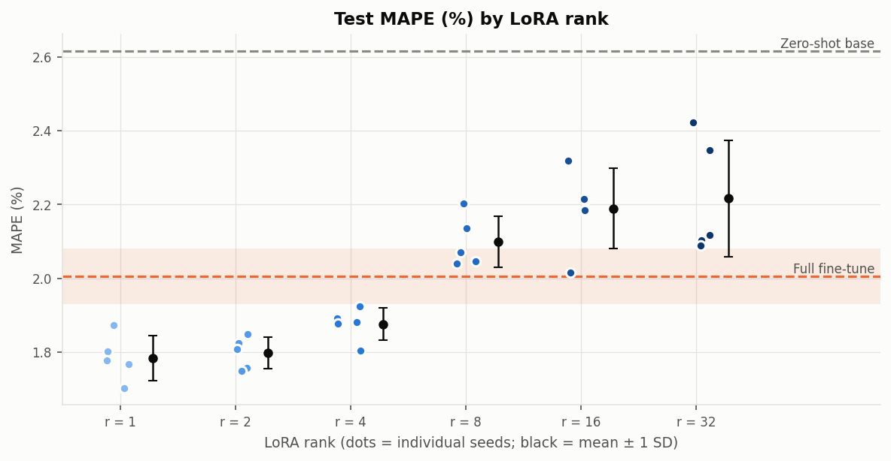
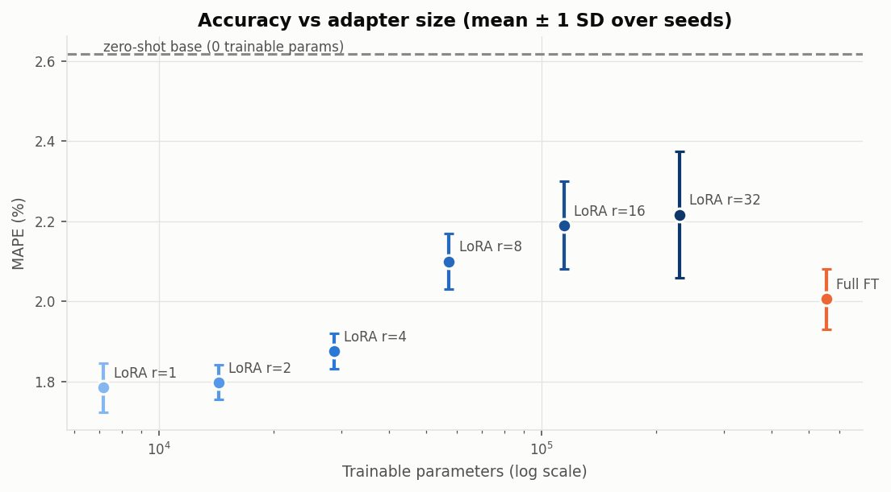
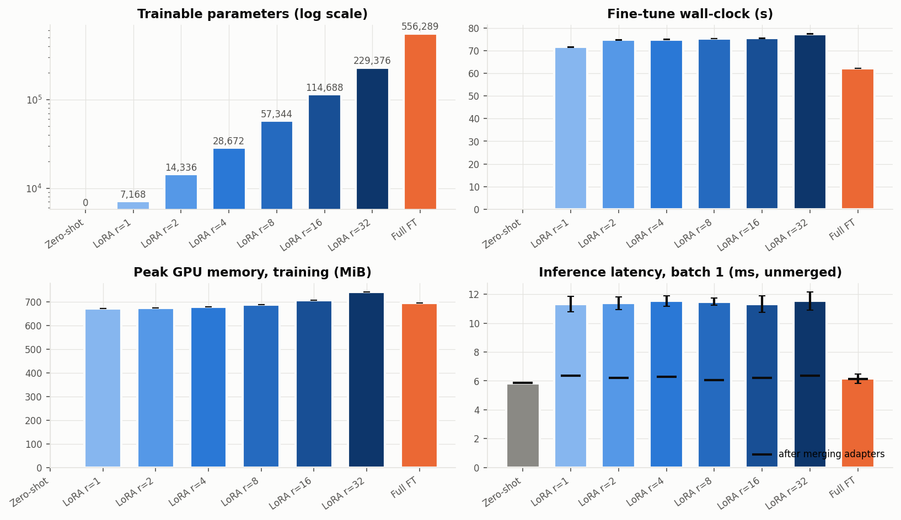
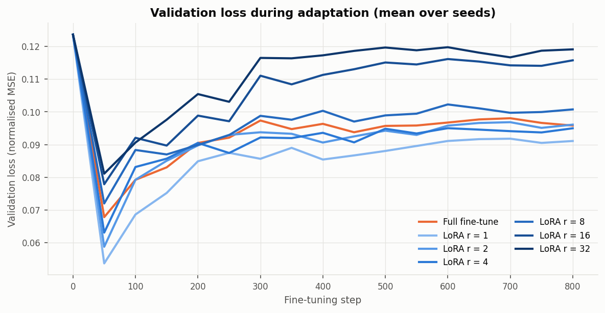
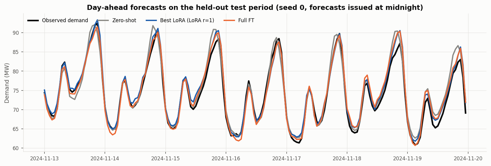
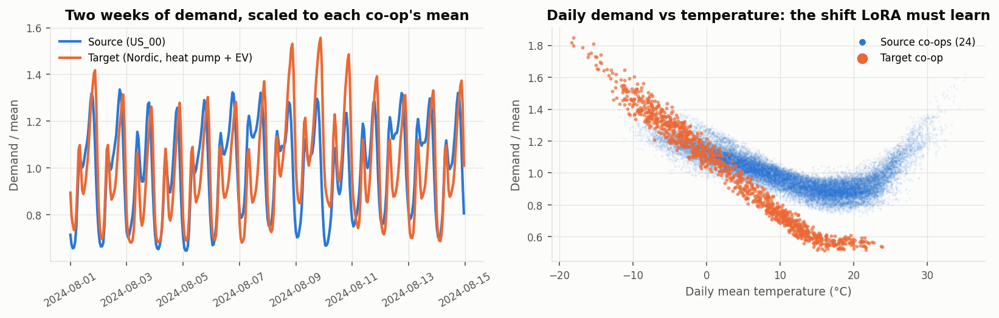

# Does LoRA rank matter for day-ahead demand forecasting?

A controlled, reproducible ablation for **Cobalt Grid**, which sells short-horizon electricity-demand forecasts to
rural utility co-ops in the EU and US. Cobalt Grid adapts one shared forecasting model to each new co-op with a small
LoRA adapter. This study answers one release question: **which adapter rank should we ship, and are the differences
between ranks larger than run-to-run noise?**

| | |
|---|---|
| **Factor** | LoRA rank r ∈ {1, 2, 4, 8, 16, 32}, with α = 2r (constant scale α/r) |
| **Replication** | 5 seeds per rank, plus two brackets: zero-shot (no adaptation) and full fine-tuning |
| **Task** | Forecast the next 24 h of territory demand (MW) from 168 h of history, temperature and calendar |
| **Data** | Synthetic, seeded and hashed: 24 source co-ops for pretraining, 1 Nordic target co-op (heat pumps + EV) with 90 days of history |
| **Reported** | MAPE / MAE / RMSE / daily-peak error as mean ± seed SD with 95% CIs, a noise test, wall-clock, peak GPU memory, latency, adapter size |
| **Budget** | One free-tier Colab T4 session, about 30 minutes end to end |

The results summary is in [results/summary.md](results/summary.md) and the plain-language answer is in
[results/verdict.md](results/verdict.md). Compliance documentation is in
[docs/Annex_IV_Technical_Documentation.md](docs/Annex_IV_Technical_Documentation.md).

---

## 1. Reproduce it

### Option A: Google Colab (the reference environment)

1. Open [`notebooks/colab_lora_rank_ablation.ipynb`](notebooks/colab_lora_rank_ablation.ipynb) in Colab
   (*File → Open notebook → GitHub* and paste this repository's URL).
2. *Runtime → Change runtime type → **T4 GPU***.
3. *Runtime → **Run all***. The notebook clones the repo, installs the pinned dependencies and runs the five stages. It
   then displays the tables and figures and downloads `cobalt_results.zip`.
4. To store the results with the code, unzip `cobalt_results.zip` at the repository root and commit.

If Colab disconnects during stage 3, run all cells again. Finished runs are read from `results/runs.csv` and skipped.

### Option B: any machine with Python 3.11–3.13

```bash
git clone https://github.com/nmilleson/csp-cst627-week7.git
cd csp-cst627-week7
python -m venv .venv && source .venv/bin/activate      # Windows: .venv\Scripts\activate
pip install -r requirements.txt

python scripts/run_all.py --config configs/smoke.yaml     # ~2 min dry run on CPU; writes *_smoke/ only
python scripts/run_all.py --config configs/ablation.yaml  # full study (GPU strongly recommended)
```

On CPU the full study takes many hours: about 2 s per step for the full-size model. The smoke config runs the
identical code path with a tiny model and finishes in about 2 minutes.

### Running stages individually

Every stage reads the same YAML config and can be rerun on its own:

| Stage | Command | Produces |
|---|---|---|
| 1 Data | `python scripts/01_make_data.py --config configs/ablation.yaml` | `data/*.csv.gz`, `data/manifest.json` (SHA-256), `data/data_card.json`, `results/fig_data_overview.png` |
| 2 Pretrain | `python scripts/02_pretrain.py ...` | `artifacts/base_model.pt`, `results/pretrain_summary.json`, `results/pretrain_curve.csv` |
| 3 Ablation | `python scripts/03_run_ablation.py ... [--fresh]` | `results/runs.csv` (one row per run), `results/curves/`, `results/predictions/`, `results/ablation_meta.json` |
| 4 Analysis | `python scripts/04_analyze.py ...` | `results/summary.{csv,md}`, `results/significance.csv`, `results/verdict.md`, `results/fig_*.png` |
| 5 Report | `python scripts/05_render_report.py ...` | `docs/Annex_IV_Technical_Documentation.md` |

### Checking that you reproduced it

- **Data:** stage 1 prints `Reproducibility check vs previous manifest: MATCH` when the regenerated data matches
  [data/manifest.json](data/manifest.json). The comparison uses `content_sha256`, a hash of the uncompressed CSV
  text. The `.gz` file hash (`sha256`) is reproducible on one platform, but it can differ between zlib builds, as it
  did between Windows and Colab. The committed manifest is from the Colab reference run, which predates the
  content hash, so the first rerun there compares `.gz` hashes.
- **Results:** compare your `results/summary.md` with the committed one. On the same GPU type, metrics agree to about 3
  decimal places. Some CUDA attention kernels are not bit-deterministic, so the last digits can differ. Timing and
  memory depend on the GPU and on co-tenancy.

---

## 2. Study design

```
 24 source co-ops (2022-01 → 2024-07)          Nordic target co-op (2024-08 → 2024-12)
 ┌───────────────────────────────┐             ┌───────────────────────────────────────────┐
 │ pretrain base transformer     │  frozen     │ train 90 d │ val 14 d │ test 30 d           │
 │ (seed 0, 556k params)         ├────────────▶│ LoRA r ∈ {1..32} × seeds {0..4}           │
 └───────────────────────────────┘  weights    │ + zero-shot, + full fine-tune brackets    │
                                               └───────────────────────────────────────────┘
```

**What changes:** only the LoRA rank r, applied to `q_proj, k_proj, v_proj, out_proj, ff1, ff2` in every block.

**What is held constant** (the controls):

- the base checkpoint;
- the data splits;
- the batch order for a given seed (a seeded sampler);
- 800 steps × batch 128, AdamW at lr 2e-3, 50-step warm-up then cosine decay;
- α/r = 2;
- checkpoint selection by validation loss, evaluated every 50 steps.

The seed controls adapter initialisation and batch order.

**Why α = 2r?** With the common fixed-α convention, the update scale α/r shrinks as r grows. That would confound
"more capacity" with "smaller steps". Holding α/r constant isolates capacity.

**Why synthetic data?** It gives a known, documented distribution shift: the target co-op has a 2× steeper heating
response from heat pumps and a late-evening EV charging peak, neither of which appears in the source population. It
also reruns byte-identically with no download or licence dependency. The generator is about 200 readable lines in
[lora_ablation/data.py](lora_ablation/data.py). Each co-op has its own simulated weather, a simulated day-ahead
temperature-forecast error, thermal inertia, irrigation, holidays, load growth and autocorrelated noise.

**How "exceeds noise" is decided** (fixed in `configs/ablation.yaml` before the run):

1. Each run's test metric is one observation. The seed is the unit of replication; overlapping forecast windows are
   never counted as independent samples.
2. Each arm is compared with the best LoRA rank by Welch's t-test, with a Holm correction across comparisons.
3. An arm is **distinguishable** only if Holm p < 0.05 **and** |difference of means| > 2 × pooled seed SD.
4. Rank as a whole is tested with a one-way ANOVA (and Kruskal–Wallis) across ranks, plus a log2(rank) trend test.

**Costs logged per run:**

- fine-tune wall-clock (CUDA-synchronised);
- peak GPU memory, both total and above the resident dataset;
- trainable parameters and adapter size;
- median forward latency at batch 1 and batch 256, measured **before and after merging** the adapter into the base
  weights.

## 3. Results

Reference run: Colab Tesla T4, torch 2.11.0+cu130, Python 3.13, commit `b564b72`. The 36 runs took about 43 minutes
of fine-tuning plus 7.5 minutes of pretraining. All tables are in [results/summary.md](results/summary.md).

| Arm | Test MAPE % (mean ± seed SD) | Trainable params | vs best (r = 1) |
|---|---|---|---|
| Zero-shot base | 2.616 | 0 | worse |
| **LoRA r = 1** | **1.784 ± 0.061** | 7,168 | best |
| LoRA r = 2 | 1.797 ± 0.043 | 14,336 | within noise |
| LoRA r = 4 | 1.876 ± 0.044 | 28,672 | within noise |
| LoRA r = 8 | 2.099 ± 0.070 | 57,344 | worse |
| LoRA r = 16 | 2.190 ± 0.110 | 114,688 | worse |
| LoRA r = 32 | 2.216 ± 0.157 | 229,376 | worse |
| Full fine-tune | 2.005 ± 0.076 | 556,289 | worse |

**Answer:** yes, rank matters more than seed noise, but **smaller is better** here. Ranks 1–4 are statistically tied.
Ranks 8 and above, and full fine-tuning, are clearly worse: Holm-adjusted p < 0.01 and the gap is more than 2 seed SDs.
MAPE rises by about 0.10 pp per doubling of rank. The learning curves show why: with 90 days of late-summer data,
every arm reaches its best validation loss within the first 50 steps and then over-fits, and higher ranks over-fit
more. The ordering of ranks holds at every checkpoint from step 50 to step 800.

**Cost:**

- Wall-clock (72–77 s) and peak memory (672–742 MiB) grow only slightly with rank.
- Adapter storage grows linearly, from 28 KiB to 896 KiB per co-op.
- *Unmerged* adapters roughly double batch-1 latency (11.3 vs 5.8 ms). **Merged** adapters match the base model,
  so adapters should always be merged before serving.

**Recommendation:** ship **r = 1**, the smallest rank tied with the best. This is conditional on the limitations below,
especially checkpoint granularity and real-data replication.

| | |
|---|---|
|  |  |
|  |  |




## 4. What this study cannot conclude

This is a short version; the full list is §6 of the Annex IV document.

- **Checkpoint granularity.** 86% of adapted runs peaked at the first validation checkpoint (step 50). The study
  cannot see whether larger ranks would match r = 1 if stopped earlier, or trained with a lower learning rate. A
  follow-up with validation every 5–10 steps would settle it.
- **No real-world accuracy claim.** The evidence covers one synthetic target co-op and one 30-day autumn test window.
- **One base model.** Variance between pretraining seeds is not measured.
- **One training recipe.** Higher ranks might prefer a different learning rate. The question answered is "rank at a
  fixed recipe", not "each rank at its best".
- **Limited power.** With 5 seeds, only effects of about 2 seed-SDs or more are detectable. "Within noise" means "no
  effect large enough to see", not "no effect".
- **Small model.** The model has 556k parameters, so memory and latency trends will not transfer to LLM-scale LoRA.

## 5. Repository layout

```
configs/ablation.yaml          the study (every seed and hyper-parameter)
configs/smoke.yaml             tiny dry run; inherits ablation.yaml
lora_ablation/                 library code
  data.py                      seeded synthetic co-op generator
  windows.py                   GPU-resident series and on-the-fly windowing
  model.py                     transformer forecaster with named linear layers
  lora.py                      LoRALinear, apply_lora, merge_lora (no external PEFT dependency)
  train.py                     training loop, evaluation, latency and memory measurement
  plots.py                     figures
  utils.py                     config, seeding, hashing, environment snapshot
scripts/01..05_*.py, run_all.py   entry points (all accept --config)
notebooks/                     Colab notebook (+ build_notebook.py, which generates it)
docs/                          Annex IV-style documentation, its template, video walkthrough outline
results/                       committed outputs of the reference run
data/manifest.json, data_card.json   provenance; the CSVs themselves are regenerated
```

## 6. Environment

- `requirements.txt` pins everything, including `torch==2.14.0`.
- `requirements-colab.txt` pins everything **except torch**. Colab's preinstalled CUDA build is used so the CUDA build
  matches the driver.
- The torch, CUDA, GPU and library versions actually used are written to `results/ablation_meta.json` and into the
  Annex IV document.
- Reference run: Colab, Python 3.13, torch 2.11.0+cu130, Tesla T4. Smoke-tested locally on Python 3.11.9 /
  Windows 11 (CPU).
- On Colab, pip reports conflicts between the pinned pandas/numpy and Colab's preinstalled `google-colab`,
  `cudf` and `numba`. The study never imports those packages, and its scripts run in separate processes, so the
  warnings are harmless.
- PyTorch also warns that CUDA memory-efficient attention is non-deterministic. Determinism is enforced with
  `warn_only=True`, so GPU reruns agree closely but not bit-for-bit.
